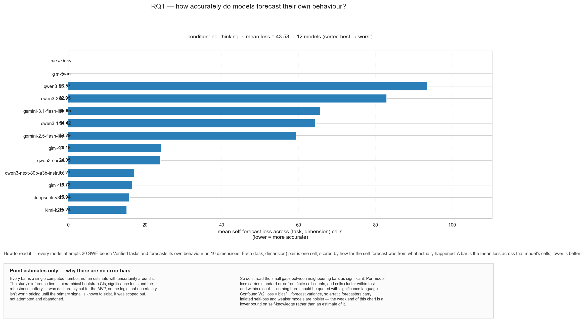
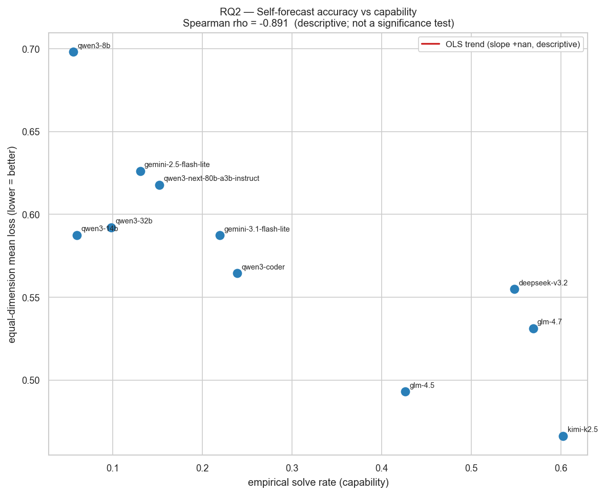
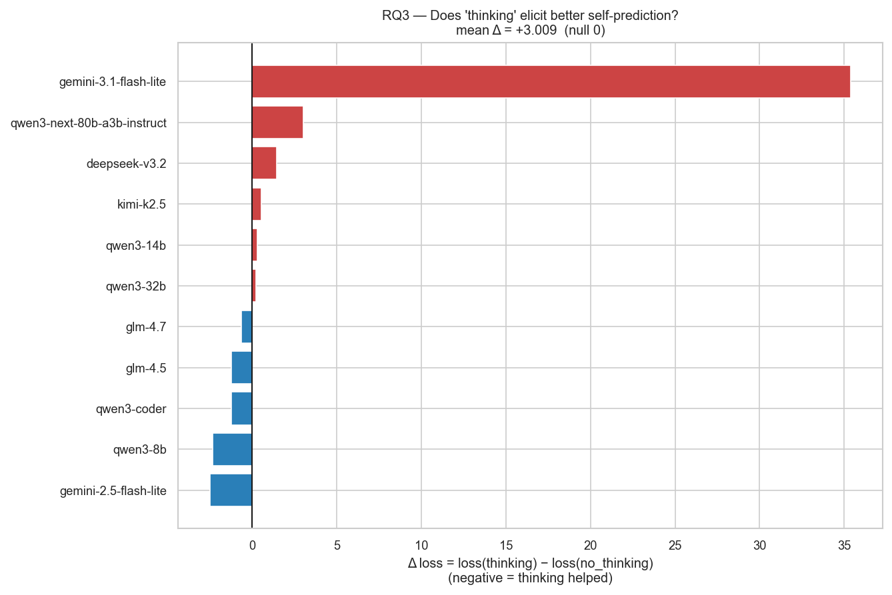
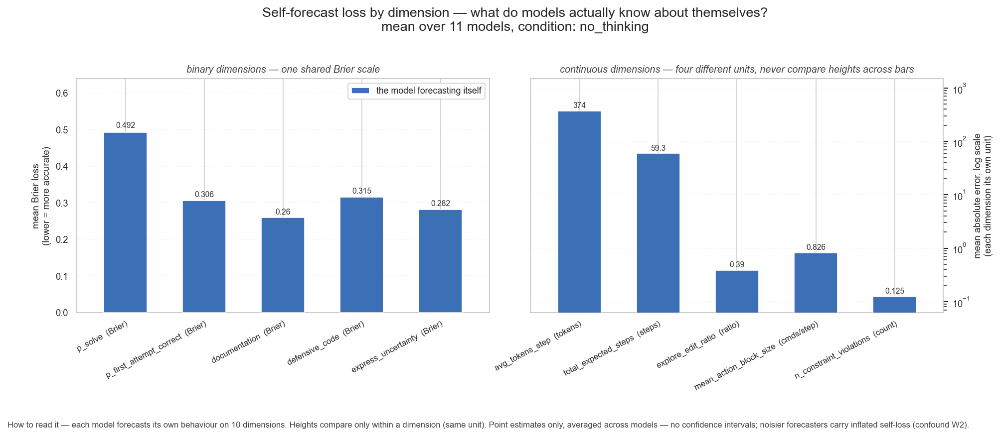
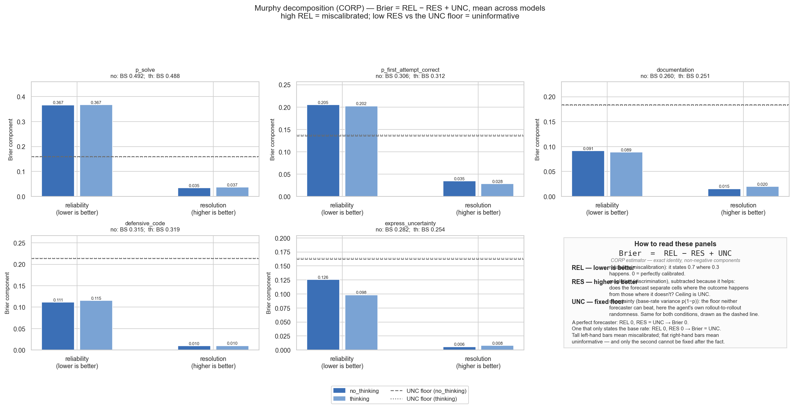
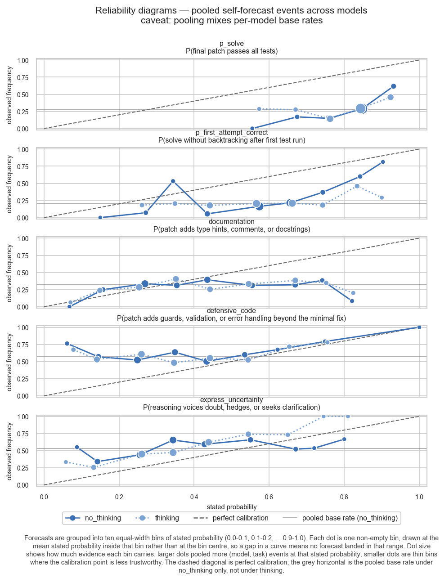

# Do coding agents know themselves? — Self-prediction on SWE-bench Verified

**Experiment 1 report — self-only analysis (rescored 2026-08-03).**
Artifacts: [`results/`](results/) (scores, analysis, Murphy decomposition, figures).
Pipeline: [`run.py`](run.py) (8 stages), spec constants in [`config.py`](config.py).

## TL;DR

Eleven models each attempted 30 SWE-bench Verified tasks (8 rollouts each) and forecast **their own** behavior on each task across 10 dimensions. GLM-5 has outcomes and rollouts in the cache but no self-forecasts (it was the cross-predictor in the original run and was never re-elicited).

1. **Self-forecasts are miscalibrated on capability** (Murphy): on `p_solve`, mean Brier ≈ 0.49 — worse than a constant 0.5 guess (0.25). Reliability (REL ≈ 0.37) dwarfs resolution (RES ≈ 0.04).
2. **Better models self-predict more accurately** (RQ2): Spearman ρ ≈ −0.81 between mean self loss and empirical solve rate (descriptive; higher solve rate ↔ lower loss).
3. **"Thinking" does not help on average** (RQ3): mean Δloss = +3.0 (thinking − no_thinking); positive means thinking made forecasts worse under the pooled headline metric.
4. **Headline loss is dominated by continuous dims** — tokens, steps, and counts swamp the binary Brier terms when dimensions are averaged without weighting. Read per-dimension panels, not the single pooled bar.

---

## Research questions

- **RQ1 (accuracy):** How accurate are self-forecasts? Reported as mean loss across dimensions and cells (lower = better).
- **RQ2 (scaling):** Does self-forecast accuracy track capability? Spearman ρ of mean loss vs empirical solve rate.
- **RQ3 (elicitation):** Does explicit reasoning ("thinking") improve self-forecasts? Paired Δloss = loss(thinking) − loss(no_thinking).

All readouts are **point estimates only**; the inferential statistics tier is pruned for the MVP.

---

## Setup

| | |
|---|---|
| Tasks | 30 SWE-bench Verified (10 easy / 10 medium / 10 hard), seed 42 |
| Models | 12 in the battery; **11 scored** (self-forecasts only) |
| Rollouts | 8 per (model, task), `mini-swe-agent` in Docker, 250-step budget |
| Forecast dims | 10 (5 binary Brier, 5 continuous MAE) |
| Conditions | `no_thinking` vs `thinking` (API reasoning or prompt instruction) |
| Samples | 5 independent forecast samples per cell, mean-aggregated |

The pipeline ([`run.py`](run.py)): dataset → rollouts → ground truth → self-forecasting → scoring → analysis → Murphy → figures.

**Rescore from cache** (no API, no Docker) after pulling `data_real/`:

```bash
python run.py --rescore-only --data-dir data_real --results-dir results
```

---

## Results

### RQ1 — Self-forecast accuracy

Mean self loss (no_thinking), averaged across dimensions and cells: **43.6** (native units pooled — interpret per-dimension panels instead).

Best self-predictors (lowest loss): kimi-k2.5 (15.2), deepseek-v3.2 (15.9), glm-4.5 (16.8).
Weakest: qwen3-8b (93.6), qwen3-32b (83.0), gemini-2.5-flash-lite (59.3).

On **`p_solve` alone** (Brier): mean ≈ **0.492** across models — severe overconfidence.



### RQ2 — Accuracy vs capability

Spearman ρ = **−0.81** between mean self loss and empirical solve rate.



### RQ3 — Thinking effect

Mean Δloss = **+3.0** (null 0). Mixed per-model deltas; gemini-3.1-flash-lite shows a large thinking penalty on the pooled metric.



### Per-dimension loss



### Murphy decomposition (binary dims)

On `p_solve` (no_thinking, mean across 11 models): REL ≈ 0.37, RES ≈ 0.04, UNC ≈ 0.16 → BS ≈ 0.49.

Error is overwhelmingly **miscalibration** (high REL), not missing discrimination (low RES vs UNC floor).




---

## Caveats

- **Descriptive only** — no bootstrap CIs or significance tests in this MVP readout.
- **GLM-5 unscored** — no self-forecasts in the published cache; add `forecasts/self/z-ai__glm-5/` and re-run `--rescore-only` to include it.
- **Headline mean loss mixes units** — binary Brier (0–1) averaged with token/step MAE; use per-dimension figures for interpretation.
- **Forecast variance (W2)** — noisier forecasters carry inflated loss; weaker models tend to be noisier.

---

## Reproduce

```bash
# Pull cache (tasks, forecasts, outcomes from git; rollouts from release exp1-rollouts-v1)
python run.py --rescore-only --data-dir data_real --results-dir results
python make_plots.py --results-dir results
python plots.py --results-dir results
```

| Artifact | Path |
|----------|------|
| Scores | [`results/scores.json`](results/scores.json) |
| Analysis | [`results/analysis.json`](results/analysis.json) |
| Murphy | [`results/murphy.json`](results/murphy.json) |
| Headline figures | [`results/plots/`](results/plots/) |
| Full figure set | [`results/figures/`](results/figures/) |
